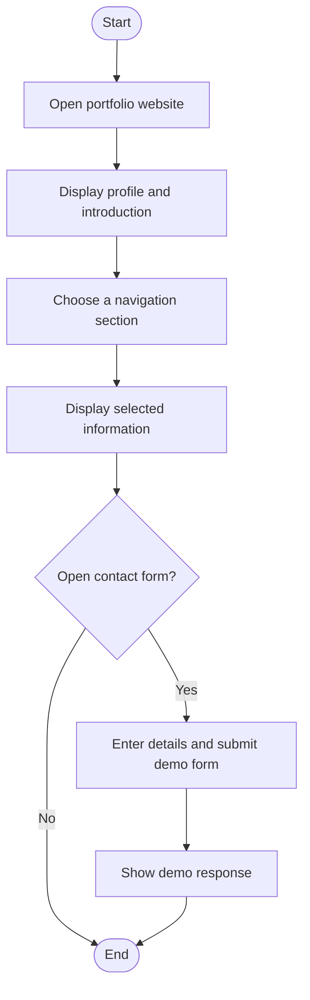

# Personal Portfolio Website — Algorithm, Flowchart and Testing

## Algorithm
1. Start.
2. Open the portfolio home page.
3. Display the introduction and profile.
4. Use the navigation links to open About, Education, Skills, Projects, or Contact.
5. Display the selected section.
6. If the visitor enters contact details and submits the form, show the form's demo response.
7. Stop.

## Simple Flowchart

## Main Web Technologies
- HTML: webpage structure and sections.
- CSS: responsive layout, colors, navigation and animation.
- JavaScript: demo interaction where provided.

## How to Run
Open `index.html` in a web browser. Replace the sample profile, education, skills, projects and contact information with your own details before submission.

## Test Checklist
- [ ] Home page and introduction display.
- [ ] Navigation links move to the correct sections.
- [ ] Education, skills and project sections display.
- [ ] Contact form fields accept input.
- [ ] Page layout adapts to a narrow/mobile screen.
