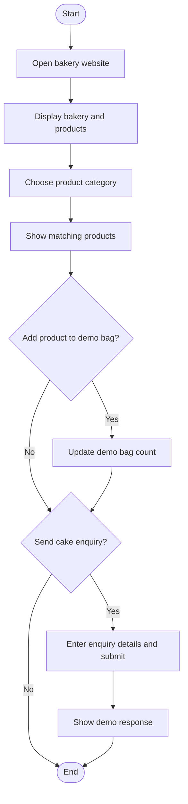

# Bakery and Cake Shop Website — Algorithm, Flowchart and Testing

## Algorithm
1. Start.
2. Open the bakery home page.
3. Display the bakery introduction and products.
4. Select a product category.
5. Display the matching products.
6. Visitor may add a product to the demo bag or enter a custom cake enquiry.
7. Display the demo bag count or form response.
8. Stop.

## Simple Flowchart

## Main Web Technologies
- HTML: product cards, menu, enquiry form and contact sections.
- CSS: responsive product grid, colors, spacing and hover effects.
- JavaScript: product category filtering and demo bag interaction.

## How to Run
Open `index.html` in a web browser. Product names, prices and store details are sample content. Update them with accurate details before submission.

## Test Checklist
- [ ] Bakery home page displays.
- [ ] Product cards and prices display.
- [ ] Category filters show matching products.
- [ ] Demo bag count changes when a product is added.
- [ ] Enquiry form accepts input.
- [ ] Layout works on a narrow/mobile screen.

*Note: The demo bag does not place a real order and the enquiry form does not send a real message.*
