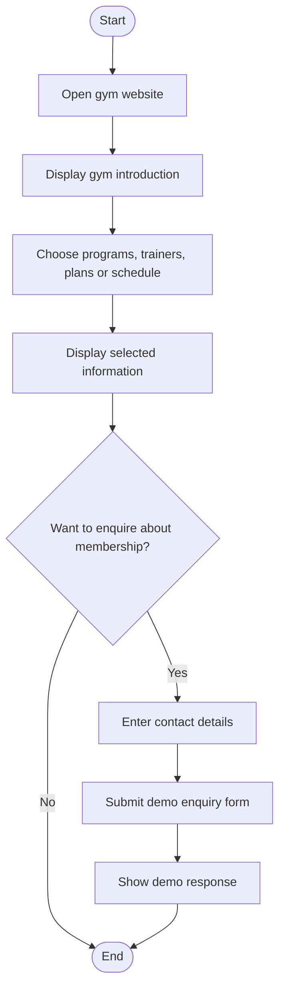

# Fitness Center and Gym Website — Algorithm, Flowchart and Testing

## Algorithm
1. Start.
2. Open the gym home page.
3. Display the gym introduction and fitness information.
4. Navigate to workout programs, trainers, membership plans, or schedule.
5. Display the selected information.
6. Visitor may select a membership plan and enter details in the enquiry form.
7. Display the demo form response.
8. Stop.

## Simple Flowchart

## Main Web Technologies
- HTML: sections, trainer cards, membership cards, schedule and form.
- CSS: responsive layout, colors, cards and hover transitions.
- JavaScript: demo interaction where provided.

## How to Run
Open `index.html` in a web browser. Trainer names, membership prices and contact information are sample details. Replace them with correct information before submission.

## Test Checklist
- [ ] Gym home page displays.
- [ ] Workout program cards display.
- [ ] Trainer details display.
- [ ] Membership plans and schedule display.
- [ ] Enquiry form accepts input.
- [ ] Layout works on a narrow/mobile screen.

*Note: The form is a front-end demonstration; it does not create a real membership.*
