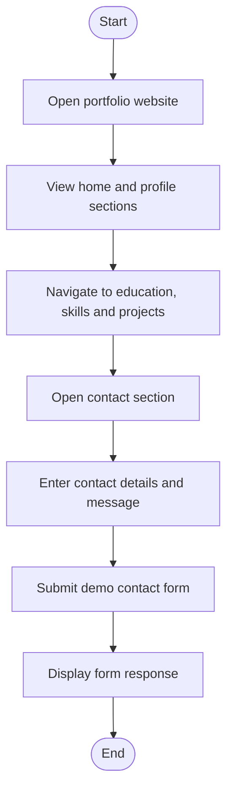
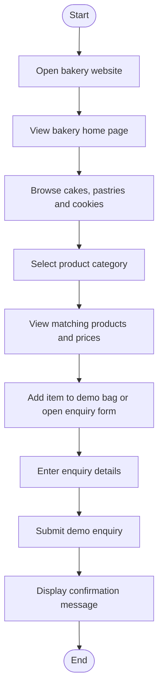
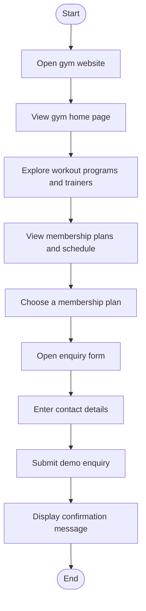

# Web Development ABL — All Three Flowcharts

This file contains the simple flowcharts for the three selected website projects in one place.

## 1. Personal Portfolio Website

**Purpose:** Display personal details, education, skills, projects and contact information.

## 2. Bakery and Cake Shop Website

**Purpose:** Display bakery products, prices, shop information and a cake enquiry form.

## 3. Fitness Center and Gym Website

**Purpose:** Present gym programs, trainers, membership plans, schedule and enquiry details.

## Notes

- These are simplified website navigation and interaction flowcharts.
- The forms on these sample websites are demonstrations; they do not send real messages, orders or membership registrations.
- Open each project's `index.html` file in a browser to view the website.
